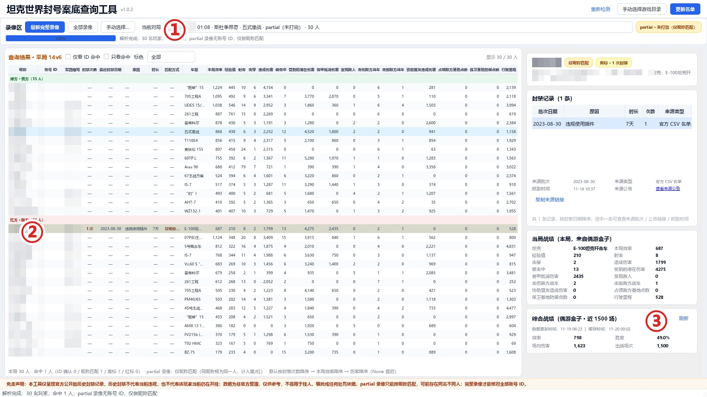

# 坦克世界封号案底查询工具（wot-ban）

> **坦克世界（360 国服）历史封禁名单本地档案库 + 本地录像逐局比对工具。**
> 全本地运行、不上传数据、无遥测；只读官方公开的封禁名单与本地 `.wotreplay` 录像文件。
>
> ⚠️ **历史封禁记录 ≠ 当前违规 / 当前开挂**。本工具仅呈现官方公开的历史记录，非官方口径，**禁止用于挂人、网络暴力、骚扰或任何处罚依据**。

版本 **v1.0.2** ｜ 许可证 **MIT** ｜ 平台 **Windows 10 / 11** ｜ 运行环境 **Python 3.12 + PySide6**

---

## 简介

《坦克世界》360 国服官方长期发布「违规账号封禁名单」（2020-08 至今，公告 + CSV 下载）。本工具做两件事：

1. **建本地档案库**：把官方公开的历史封禁名单（96 期 CSV + 18 期 xlsx，覆盖 2020-08-14 ~ 2026-11-06）导入本地 SQLite，随时可查、可更新；
2. **逐局比对录像**：扫描本机 `.wotreplay` 录像，把一局 30 名参战玩家与历史名单一一比对，直接标出「该玩家是否上过封禁名单、几次、什么时候、为什么」。

- 完整录像（打完的局）按**账号 ID 精确匹配**，可核对每个玩家的真实账号；
- partial 录像（未打完、只含开局信息的局）只能按昵称匹配，界面明确标注「仅昵称匹配」；它同样可以查盒子当局战绩——按「对局时间 + 录像者坦克」反查盒子战斗日志得到 `arena_id`（受盒子保留窗口与 180 天限制，见下文）；
- 打开某局时按需查看盒子同款当局战绩；综合战绩仅在手动点「刷新」时请求（偶游盒子，**非官方数据、仅供参考**）。

面向个人自查与观战复盘：**只陈述「何时因何被官方封禁过」，不判断当前是否开挂、不做游戏内 overlay、不提供在线查询服务**。

## 功能

- **双击即用**：根目录提供 `坦克世界封号查询.exe` 薄启动器（约几十 KB，C# 薄壳），双击即启动 GUI；更新 Python 源码无需重新编译 exe。
- **环境自动探测**：首次启动自动探测游戏安装目录、录像目录与「我的账号」ID（读取系统注册表安装项 + 最新一份录像的玩家信息），无需手动设置；探测结果只作用于本次运行（不写入配置文件，每次启动重新探测）；探测失败可在界面「重新检测」或「手动选择游戏目录」，手动选择会写入 `config.local.json` 并在之后记住。
- **名单档案库**：官方 114 批名单（96 期 CSV + 18 期 xlsx），源记录 322,941 条（物理行口径），去重入库 322,806 条；每条记录保留来源批次、公告链接与抓取时间。
- **自动更新**：完成首次使用后的日常启动，在录像扫描结束后检查一次（扫描与更新串行，不并发写库）、运行期间每 6 小时检查一次、可手动「更新名单」；首次启动由软件内弹窗确认后下载（见「使用流程」）；不创建计划任务；遇到官方风控（403/412/429/503）立即中止并中文提示。
- **录像扫描**：「最新完整录像 / 全部录像 / 手动选择文件」三种入口，进度条与取消；损坏录像跳过不中断；扫描结果增量缓存（重复扫描秒级）。
- **双档匹配**：完整录像 → `dbid` ↔ 名单 `wgid` 精确匹配（「ID 确认」）；无 ID 时同昵称视为同一人（「昵称匹配」）；partial 录像标注「仅昵称匹配」并计入黄/红。
- **红绿方分组**：结果表按「绿方 · 我方（N 人）」「红方 · 敌方（N 人）」上下两组展示，**绿方 = 录像者本人所在队**、始终在上；组头行不参与选中与排序；**本人（录像者）行用浅蓝底 + 昵称加粗**标出，封禁黄 / 红底色优先（选中行也不盖掉标色）。
- **盒子同款战绩列**：结果表固定 24 列（前 8 列为封禁 / 匹配信息，后 16 项与盒子当局明细同序）：昵称 / 账号 ID / 军团缩写 / 封禁次数 / 最近封禁日期 / 原因 / 时长 / 匹配方式 / 车型 / 本局效率 / 经验值 / 射击 / 击穿 / 造成伤害 / 被击中 / 受到的潜在伤害 / 装甲抵消伤害 / 发现敌人 / 击伤敌方战车 / 击毁敌方战车 / 协助盟友造成伤害 / 占领敌方基地点数 / 保卫基地防御点数 / 行驶里程；「车型」显示游戏中文车名（如「五式重战」，IS-7 等原文保持），「当前对局」显示中文地图名 + **本人本局车名**（只显示名称、不显示代码，录像下拉条目同样尽量带车名）；**本局效率（即盒子效率，老玩家习惯叫法）四舍五入取整**，数字带千分位；查询结果区域不提供悬停提示。
- **胜负平标题行**：「查询结果」标题显示本局胜负平与比分（如「查询结果 · 平局 14v6」），胜绿 / 平橙 / 负红；完整局即使盒子不可用也能从录像给出胜负平，partial 局在反查成功后显示。
- **一屏 30 人**：默认 1920×1080 窗口下 30 人 + 2 个组头一屏完整显示（无纵向滚动条）；60 人局保留滚动条、一屏约 30 人。
- **黄红标记**：1 次封禁 = 黄标，≥2 次 = 红标；组内默认按封禁次数降序 → 本局效率降序 → 伤害降序（无数据置后），表头点击只在组内改排序。
- **结果筛选**：「只看命中」「仅看 ID 命中」「标色筛选」，可快速缩小到需要关注的行。
- **明细面板**：选中玩家查看全部封禁记录（批次日期 / 原因 / 时长 / 次数 / 来源链接 / 抓取时间）、账号 ID、军团缩写、当局坦克（游戏车名）、阵营（绿方 · 我方 / 红方 · 敌方），以及 16 项盒子同款当局战绩（含本局效率；每行 2 组、不需要横向滚动）与综合战绩缓存（效率 / 胜率 / 场均伤害等）；综合战绩标题行右上角是单个「刷新」按钮。
- **当局战绩（按需）**：打开一局时自动异步加载本局 30 人的盒子同款明细，不阻塞主表（仅最近 180 天内的对局会发起请求，超期局直接显示不可用）。完整局用录像自带的 `arena_id` 请求；成功后**对局战绩永久缓存、不会二次抓取**（180 天窗口内再次打开直接显示缓存、0 请求）；失败只降级提示，不影响封禁查询。
- **partial 局战绩**：partial 录像按「录像对局时间 + 录像者坦克」反查盒子战斗日志得到 `arena_id` 再取明细。盒子战斗日志有效数据约 215 页 × 每页 5 条 ≈ 1075 局，**第 216 页起返回完全重复的封顶页**，超保留窗口或超 180 天不可用；匹配采用「时间估算页 + 锚点校正 + 封顶重复检测」，不逐页扫描——单局最多 **8 次**战斗日志页请求、相邻请求 **≥3 秒**，遇 403 立即停止并进入约 **10 分钟冷却**。
- **综合战绩（单个「刷新」按钮）**：**任意选中玩家都可查**（不再要求命中封禁名单；partial 局无账号 ID 时按昵称查）；选中玩家只显示本地已缓存结果（含数据更新时间 / 缓存时间）、不发请求；需要更新时点「综合战绩」标题行右上角的「刷新」强制重新请求；≥2 秒限流；口径为「偶游盒子 · 最近 1500 场标准局」，**非官方数据、仅供参考**。
- **隐私友好**：全本地运行，无遥测、不上传、不导出名单数据；仓库与发行包不含名单数据、数据库与日志；仓库与发行包均仅含 1 张已打码的功能示意图（不含名单 / 账号等敏感信息），发行包不含其他截图。

## 安装与启动

### 便携包（推荐普通用户）

从 [GitHub Releases](https://github.com/kingbob-1/wot-ban/releases) 下载 **Windows 便携压缩包**（内嵌 CPython 3.12 + PySide6 + 运行期依赖 + 源码 + 启动器，约 285 MB，实际以 Release 页面标注为准），解压到任意目录后**双击 `坦克世界封号查询.exe`** 即可，**无需安装 Python**。包内附 1 张已打码的界面示意图（`docs\images\`，即 README 首图）。

- 首次启动会自动探测游戏目录/录像目录/我的账号，不需要手点或填写路径；
- **首次使用需在软件内两次确认**（见下方「使用流程」）：弹窗①点「开始扫描录像」后才扫描（**点击即表示你已阅读并同意使用本软件**）、扫描结束后弹窗②点「开始更新名单」后才下载官方名单；弹窗为**软件内自绘、无提示音、非系统弹窗**；完成后再次启动不再弹窗、自动扫描。
- 如启动器无法启动，可改用包内 `run.bat` 作为排障备用入口（自动使用包内 Python 启动源码）。

## 使用流程

1. **首次启动（只有第一次）**：双击 `坦克世界封号查询.exe`，程序自动探测本机环境（游戏目录 / 录像目录 / 我的账号，无需手动设置；探测失败可点「重新检测」或「手动选择游戏目录」）。空名单库首次启动**不会自动扫描、也不会自动下载名单**，而是弹出**软件内自绘弹窗①**（无提示音、非系统消息框）：
   - 点「**开始扫描录像**」（点击即表示你已阅读并同意使用本软件）后才开始扫描全部录像（首次冷启动约 1–3 分钟，取决于本机录像数量，可随时取消）；
   - 点「暂不开始」或直接关闭弹窗则本次不扫描，下次启动会再次提示；
   - 扫描结束（完成 / 取消 / 失败）后名单库仍为空时，弹出**弹窗②**：点「**开始更新名单**」后才从 360 官方公开接口只读下载历史封禁名单（约 5–6 分钟，低频只读；失败原因显示在弹窗内并可重试；点「稍后再说」则下次启动再提示）；
   - 名单下载成功且库内已有数据后写入本机完成标记：**以后启动不再弹窗**，自动按「全部录像」扫描并打开最近一局；**老用户升级新版本也不会弹首启弹窗**（已有名单库直接走日常启动）。
2. **日常启动**：自动探测环境 → 自动按「全部录像」扫描并打开最近一局；扫描结束后自动检查一次名单更新（与扫描串行、不并发写库），运行期间每 6 小时再检查一次；也可以随时手动点「更新名单」。
3. **选择录像**：点「最新完整录像」「全部录像」或「手动选择…」加载一局；扫描有进度条，可取消。
4. **看结果**：结果表按红绿方分组列出本局全部玩家（本人队在上），命中历史名单的行黄底/红底高亮，标注封禁次数、最近封禁日期、原因、时长与匹配方式；标题行显示本局胜负平与比分；点击表头在组内排序，勾选筛选框可只看命中。
5. **看明细**：点击某个玩家，右侧显示其全部封禁记录与来源批次/公告链接/抓取时间。
6. **看战绩**：打开一局（180 天内）会自动加载当局战绩（完整局与 partial 局均可，partial 依赖盒子战斗日志反查）；选中任意玩家，右侧明细会显示其封禁记录与已缓存的综合战绩，点「综合战绩」标题行右上角的「刷新」可查该玩家近况（限流；任意玩家可查）。
7. **日志与数据**：数据在 `data\wotban.db`，日志在 `log\wot-ban.log`（单一日志文件、多次启动追加）；手动选择的游戏目录 / 录像目录保存在 `config.local.json`（不入库、不上传；自动探测结果不写入该文件，每次启动重新探测）。1.0 定稿界面不再提供独立的名单库状态页，名单库规模 / 缺失批次等诊断信息可只读查看数据库或反馈时提供日志。

详细操作、参数与排错见 **[docs/使用说明.md](docs/使用说明.md)**。

## 数据来源与口径

| 项目 | 来源与口径 |
|---|---|
| 封禁名单 | 360 国服官方封禁公示（`profile.wg.360.cn/wstop`）公开接口与官方公告附件：**96 期 CSV（2021-08-16 起）+ 18 期 xlsx（2020-08-14 ~ 2021-08-11）+ 最新一期 JSON（前 100 条带账号 ID）**，合计 **114 批、覆盖 2020-08-14 ~ 2026-11-06 连续无缺口** |
| 名单条数 | **源记录 322,941 条（物理行口径）/ 去重入库 322,806 条**；差额 135 = 1 条 U+2029 伪行（昵称内含换行符被切分）+ 34 条源内重复记录 + 100 条最新 JSON `wgid` 与同批 CSV 同键归并（只补 ID、不新增行） |
| 账号 ID | 官方只在新批次（最新一期 JSON）提供前 100 条 `wgid`，历史批次**没有账号 ID**、也无法回补；因此历史名单与 partial 录像只能按昵称匹配（同昵称视为同一人，界面明确标注） |
| 录像 | 本地 `.wotreplay` 文件，**只读**，不修改游戏目录、不需要启动游戏；完整录像可解析出全部玩家账号 ID；partial 录像约占 56%，只有昵称、军团与坦克信息 |
| 本机环境 | 游戏目录/录像目录/我的账号由**动态探测**获得（系统注册表安装项 + 常见安装目录扫描 + 最新录像内嵌的玩家信息），不依赖任何写死的路径；探测失败可手动选择并记忆 |
| 战绩（可选） | 偶游盒子（`wotbox.ouj.com` / `wotapp.ouj.com`）的 `battledetail`、`battleLog` 与 `index` 页面；完整局用录像内嵌 `arena_id`，partial 局按「对局时间 + 录像者坦克」反查 `battleLog` 取得 `arena_id`；**仅最近 180 天有效、战斗日志约保留最近 1075 局、非官方数据、仅供参考**；综合战绩口径为「最近 1500 场标准局」 |
| 可核对性 | 任意一条记录可查看来源批次、公告/下载链接与抓取时间；名单库缺失批次等诊断信息在 1.0 定稿界面不再单独展示，可只读查看 `data\wotban.db` 或反馈时提供 `log\` 日志（本机档案：无缺失） |

> **公开用户首次运行的抓取范围**：首次使用经用户确认后，官方接口自动抓取的是 **CSV 系列（96 期，约 25.6 万物理行，2021-08-16 起）**；2020-08 ~ 2021-08 的 18 期 xlsx 是官方公告附件形式，**不在自动抓取范围内**，因此公开版默认档案从 2021-08-16 开始。开发/本机归档完整包含 18 期 xlsx（见上表 322,941 口径）。

## 隐私与免责

**隐私**

- 全本地运行：不联网上传任何数据、无遥测、无统计上报；
- 仓库与发行包**不含**名单数据、数据库与日志；**仓库与发行包均仅含 1 张已打码的功能示意图**（不含名单 / 账号等敏感信息），**发行包不含其他截图**；用户首次运行自行从官方公开接口抓取；
- 名单数据、数据库、日志、本机路径配置均不随仓库/发行包分发、不导出、不共享；
- 网络访问仅限：① 官方封禁名单公开接口（低频只读 GET，≥2 秒/请求、无并发）；② 打开对局 / 手动刷新玩家综合战绩时的偶游盒子只读页面（`battledetail`、partial 反查用的 `battleLog`、`index`）；不登录、不调用任何需要登录的接口。

**免责**

- 历史封禁记录 **≠ 当前违规 / 当前开挂**，也不代表该玩家现在仍在违规；
- 数据来自官方公开信息与第三方站点，**非官方口径**，可能与官方信息存在差异或滞后；
- 本工具仅供个人查阅、自我核查与观战复盘，**严禁用于挂人、网络暴力、骚扰、人肉搜索或作为任何处罚/仲裁依据**；
- partial 录像按昵称匹配，可能存在同名不同人；完整录像才能核对全部账号 ID；
- 官方接口/第三方站点可能失效、变更或限流，工具会中止并给出中文提示，不绕过风控；
- 因使用本工具产生的任何后果由使用者自行承担。

## 许可证

本项目代码以 **[MIT License](LICENSE)** 发布（Copyright © 2026 kingbob-1）。

第三方组件与合规说明：

| 组件 | 许可证 | 说明 |
|---|---|---|
| Python（便携运行时/源码运行） | PSF License | 便携包内嵌 CPython 3.12（python-build-standalone 构建），附 `LICENSE.txt` |
| 运行期 Python 依赖（requests / openpyxl） | Apache-2.0 / MIT 等 | 便携包内随附：`requests` 用于盒子战绩只读请求，`openpyxl` 用于 xlsx 期名单解析；各自许可证文件随包分发，详见 `docs/第三方组件许可.md` |
| PySide6 / Qt | LGPL-3.0 | 以动态库方式使用，未修改 Qt 源码；最终用户可替换 `PySide6/Qt` 下的动态库；本项目代码不静态链接 Qt |
| 薄启动器（C# / .NET Framework） | Windows 系统组件 | 使用 Windows 自带的 .NET Framework 4.x `csc` 编译为 WinExe 薄壳，不随包分发第三方运行时；图标为项目原创绘制 |

详见 **[docs/第三方组件许可.md](docs/第三方组件许可.md)**。

## 已知限制

- 仅支持 **Windows 10/11** 与 **360 国服**（亚服/国际服没有公开封禁名单）；
- 账号 ID 缺口是官方数据限制：历史批次无 `wgid`，只能前向累积（从 2026-11-18 起每期存档最新 100 条）+ 昵称兜底；
- 公开版首次运行（经软件内弹窗确认后）只自动抓取 CSV 期次（见「数据来源与口径」），18 期 xlsx 不在自动抓取范围内；
- 环境探测依赖本机注册表与录像文件；绿色版/免安装游戏或注册表缺失时可能探测不到，需手动选择一次（之后会记住）；
- 战绩依赖偶游盒子，仅最近 180 天、可能限流或失效，**非官方数据**；partial 局还需在盒子战斗日志保留窗口（约最近 1075 局）内且「对局时间 + 录像者坦克」能匹配，越界或匹配不上时当局战绩不可用，但封禁查询不受影响；
- 对局战绩成功获取后**永久缓存在本地数据库、不会二次抓取**（180 天窗口内再次打开直接显示缓存、0 请求）；玩家综合战绩同样本地缓存，选中玩家只显示已有缓存、点明细面板「综合战绩」标题行右上角的「刷新」才会重新请求；
- 首次使用需要在软件内两次确认（扫描录像 → 下载官方名单），这是为了避免首启全量扫描与名单更新并发写库导致名单库为空；点「暂不开始」/「稍后再说」或关闭弹窗则本次不执行、下次启动继续提示；**老用户升级不会弹首启弹窗**；
- 启动器是薄壳 exe，不内嵌 Python；便携包以「启动器 + 内嵌运行时 + 运行期依赖 + 源码」形式分发。

## 致谢

- **灵感来源**：B 站 UP 主 **复仇-沃尔特**（<https://space.bilibili.com/2330339>）的视频《我花50块让AI跑了个查询坦克世界开挂案底的软件》（[BV1iQsz6MEyA](https://www.bilibili.com/video/BV1iQsz6MEyA)）——感谢其演示与思路启发。
- **独立实现声明**：本项目为**独立重写**，未使用原软件的任何代码与数据；名单数据直接从 360 官方公开渠道获取，战绩数据来自偶游盒子公开页面，界面与实现均为本项目自行编写。
- 本项目为个人开发的非官方工具，与 Wargaming、360 游戏及偶游盒子无任何关联，未获其授权或背书。封禁名单数据版权归 360 官方所有，战绩数据版权归偶游盒子所有；本仓库仅包含代码、说明与 1 张已打码的功能示意图，不包含、不转发、不导出任何名单数据与原始界面截图。
